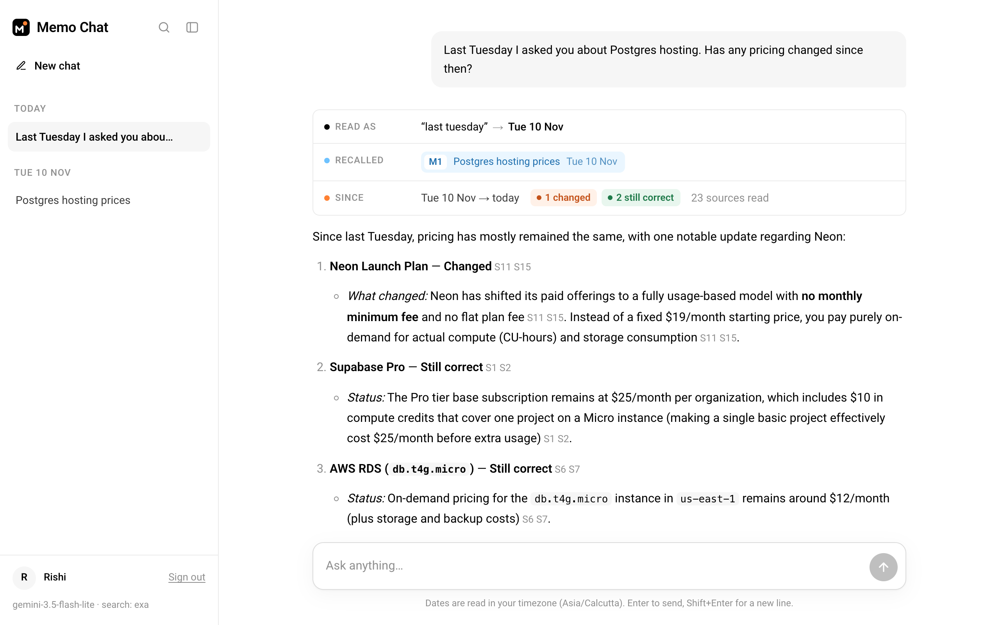
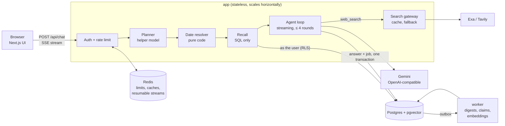
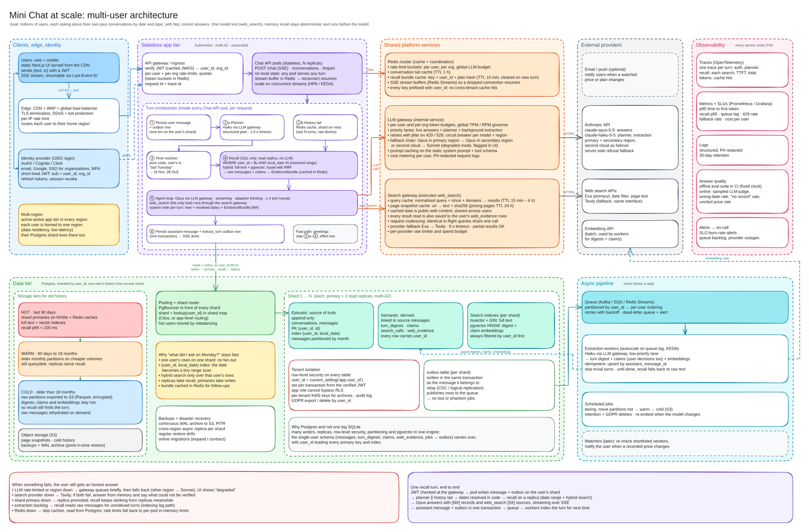

<div align="center">


# Memo Chat

**A research assistant that remembers what you asked, and checks whether it is still true.**

[**Try it live → memo-chat.up.railway.app**](https://memo-chat.up.railway.app)

</div>

Ask it *"Last Tuesday I asked you about Postgres hosting. Has any pricing changed since then?"* and Memo Chat works out which Tuesday you mean in your timezone, finds the conversation from that day (in any of your chats), re-checks the vendors' own pricing pages, and tells you item by item what **changed**, what is **still correct**, and what it **couldn't verify**, with sources and dates.

It has exactly one tool, web search. Memory is not a tool: it is plain SQL that runs before the model is called, so recall is fast, deterministic and testable.

<p align="center">
  
</p>

**What you get**

- **Memory across all your chats.** "What did I ask you on 3 November?", "who were we discussing this morning?" Dates are resolved in code, in your timezone, and said back to you.
- **Live answers with sources.** Parallel web searches with publish-date filters, primary sources first, inline citations you can click.
- **Honest verification.** Every recalled claim is labelled *changed*, *still correct* or *couldn't verify*. No record means "no record", never a guess.
- **Built for many users.** Postgres row-level security per user, Redis for caches, limits and resumable streams, a background worker for memory indexing.
- **A calm, fast UI.** Smooth streaming, edit any message you sent, search your chats, a resizable sidebar, light and dark mode, sign-in with email, Google or GitHub.

---

## Contents

1. [Run it on your machine](#run-it-on-your-machine) (macOS and Windows)
2. [Configuration](#configuration)
3. [Tests, evals and load tests](#tests-evals-and-load-tests)
4. [Architecture](#architecture)
5. [Tech stack](#tech-stack)
6. [The journey](#the-journey): how Memo Chat was built, and why
7. [Project layout](#project-layout)

---

## Run it on your machine

Everything (Postgres with pgvector, Redis, migrations, demo data, the app and the worker) runs in Docker. You need two API keys, both with free tiers:

| Key | Where to get it |
|---|---|
| `LLM_API_KEY` | A Gemini key from [Google AI Studio](https://aistudio.google.com/apikey). Any OpenAI-compatible endpoint works; see [Configuration](#configuration). |
| `EXA_API_KEY` | [exa.ai](https://exa.ai) (or use Tavily: `SEARCH_PROVIDER=tavily` and `TAVILY_API_KEY`). |

If a key is missing the app still starts and tells you what to fill in.

### macOS

1. **Install the prerequisites**
   - [Docker Desktop for Mac](https://docs.docker.com/desktop/setup/install/mac-install/) (Apple silicon or Intel). Open it once so the Docker engine is running.
   - Git: run `git --version` in Terminal. If it is missing, macOS offers to install the Command Line Tools.
   - Optional, only for running tests or developing outside Docker: [Node.js 22 or newer](https://nodejs.org/) (`brew install node` works).

2. **Get the code**

   ```bash
   git clone https://github.com/preeeetham/memo-chat.git
   cd memo-chat
   ```

3. **Add your keys**

   ```bash
   cp .env.example .env
   open -e .env      # set LLM_API_KEY and EXA_API_KEY, then save
   ```

4. **Start everything**

   ```bash
   docker compose up --build
   ```

   The first build takes a few minutes. When you see the app listening on port 3000, open **http://localhost:3000**.

5. **Sign in.** Locally the app uses a simple username sign-in. Use **`demo`** to see three preloaded, backdated conversations, or any other name for a fresh, separate history.

6. **Stop it** with `Ctrl+C`, or `docker compose down` (your data stays in a Docker volume; add `-v` to wipe it).

### Windows

1. **Install the prerequisites**
   - [Docker Desktop for Windows](https://docs.docker.com/desktop/setup/install/windows-install/) with the **WSL 2** backend (the installer offers it; accept the restart). Open Docker Desktop once so the engine is running.
   - [Git for Windows](https://git-scm.com/download/win). During setup, choose **"Checkout as-is, commit Unix-style line endings"** so the shell scripts keep working.
   - Optional, only for tests or developing outside Docker: [Node.js 22 or newer](https://nodejs.org/) (or `winget install OpenJS.NodeJS.LTS`).

2. **Get the code** (PowerShell)

   ```powershell
   git clone https://github.com/preeeetham/memo-chat.git
   cd memo-chat
   ```

3. **Add your keys**

   ```powershell
   Copy-Item .env.example .env
   notepad .env      # set LLM_API_KEY and EXA_API_KEY, then save
   ```

4. **Start everything**

   ```powershell
   docker compose up --build
   ```

   Then open **http://localhost:3000** and sign in as **`demo`** (or any name).

5. **Stop it** with `Ctrl+C`, or `docker compose down`.

> **Ports in use?** The stack uses 3000 (app), 5433 (Postgres) and 6380 (Redis). Change them with `APP_PORT`, `POSTGRES_PORT` or `REDIS_PORT` in `.env`.

### Run the tests

With Node.js installed, start just the databases and run the suite. The commands are the same on macOS and Windows:

```bash
docker compose up -d postgres redis migrate   # databases + schema
npm install
npm test                                      # unit + integration tests
```

Integration tests use throwaway databases on the compose Postgres and skip themselves if it is not running.

### Develop without the app container

```bash
docker compose up -d postgres redis migrate
npm install
npm run dev        # http://localhost:3000, hot reload
npm run worker     # in a second terminal: memory indexing
```

The defaults in `src/config.ts` point at the compose ports, so `.env` only needs the API keys.

---

## Configuration

All settings live in `.env` (see [.env.example](.env.example) for every key, with comments).

**Model and search**

| Setting | Default | |
|---|---|---|
| `LLM_API_KEY`, `LLM_BASE_URL`, `LLM_MODEL` | Gemini `gemini-3.5-flash-lite` | Any OpenAI-compatible endpoint |
| `HELPER_MODEL` | same as `LLM_MODEL` | Cheaper model for planning and memory extraction |
| `LLM_FALLBACK_MODEL` | none | Used when the main model is rate-limited or down; the answer is marked as degraded |
| `EMBEDDING_MODEL` | `gemini-embedding-001` | Hybrid recall (full text + vectors). Empty = full text only |
| `SEARCH_PROVIDER`, `SEARCH_FALLBACK_PROVIDER` | `exa`, none | `exa` or `tavily` |

**Sign-in** (`AUTH_MODE`)

| Mode | What it is |
|---|---|
| `password` (default when unset) | Email and password (scrypt hashes, rate-limited), plus **Google and GitHub** when the four `FIREBASE_*` values are set. A verified Google email that matches an email account signs in to that account. |
| `dev` | Pick any username, no password. Local only; `docker compose` uses it so the `demo` user works. |
| `oidc` | Any OpenID Connect provider (Auth0, Okta, Cognito, Keycloak, Entra, Clerk). |

For Google and GitHub sign-in: create a Firebase project, enable both providers (GitHub needs an OAuth app whose callback is the URL Firebase shows), add your domain under **Authentication → Settings → Authorized domains**, register a web app, and copy `apiKey`, `authDomain`, `projectId` and `appId` into `FIREBASE_API_KEY`, `FIREBASE_AUTH_DOMAIN`, `FIREBASE_PROJECT_ID`, `FIREBASE_APP_ID`. The server verifies Firebase ID tokens against Google's public keys, so no service account is needed.

For any shared deployment set a real `AUTH_SECRET` (`openssl rand -hex 32`), `PUBLIC_URL`, `DEMO_TOOLS=false` and `SEED_DEMO=false`.

**Limits**

| Setting | Default | |
|---|---|---|
| `RATE_LIMIT_PER_MINUTE` | 20 | Chat turns per user per minute |
| `DAILY_TOKEN_BUDGET` | 0 (off) | Optional cap on tokens per user per UTC day |

If Redis goes down the app keeps working: caches are skipped, limits are counted per process, and the worker picks jobs up from Postgres.

---

## Tests, evals and load tests

| Command | What it does |
|---|---|
| `npm test` | Date resolution (47 cases), auth and Firebase token checks, the search gateway and limits; plus integration tests when Postgres is up: per-user isolation, cross-chat recall by time, editing and truncation, accounts and account linking |
| `npm run smoke` | End to end against a running stack: sign-in, isolation over HTTP, a real streamed turn, resume after a dropped connection, the worker indexing it |
| `npm run eval` | The sample questions and edge cases against seeded history with a frozen clock, in a throwaway database; writes `eval-results.md` |
| `bash loadtest/run.sh` | Locust load test: many users through a load balancer in front of three app replicas, every response checked for the right date and zero cross-user leaks |
| `npm run typecheck` | `tsc --noEmit` |

The load test mocks the model and web search, so it costs nothing. Last run on a laptop: **300 users, 14,806 chat turns at about 95 requests/s, 0 failures, 0 cross-user leaks**, every recall on the right date; p95 0.66 s for "no record" and 1.2–2.0 s for recall plus web verification.

**Try memory without waiting a week:** sign in as `demo`, or open **demo tools** (bottom left, local only) to load backdated history into your own account and freeze the clock. You can also import your own transcripts with `POST /api/import`.

---

## Architecture



**One turn, end to end**

1. The session is verified and the user's id becomes `app.user_id` for every database transaction. **Row-level security** on every table means a query can only ever see that user's rows.
2. A small **planner** call classifies the message (chat, lookup, recall, recall-and-verify, research) and pulls out time expressions, keywords and entities. If it fails, regex rules take over.
3. **Dates are resolved in code**: "last Tuesday" becomes candidate date ranges in the user's timezone (just after midnight, "this morning" also covers the day that just ended).
4. **Recall** (SQL only, no model call) filters by date first, then fuses full-text and vector matches (reciprocal rank fusion) across all of the user's chats. The result goes to the model as `[M1]`, `[M2]` records.
5. The **agent loop** streams the answer, calling `web_search` (up to 5 parallel queries per call, with date and domain filters) when it needs current facts. Results are cited as `[S1]`, `[S2]`.
6. The answer and its memory-indexing job are written **in one transaction** (an outbox). The **worker** then extracts a digest, a claims ledger (what was said, the value, the source and when it was seen) and an embedding, so later turns can verify "is that still true?".
7. Every streamed event is buffered in Redis with an id, so a dropped connection **resumes** where it left off.

The many-user design target (sharding by user, hot/warm/cold history, an LLM gateway, multi-region) is drawn below:

<p align="center">
  
</p>

---

## Tech stack

| Layer | Choice | Why |
|---|---|---|
| UI and API | **Next.js 16** (App Router), React 19, TypeScript | One deployable for UI and streaming API routes |
| Model | **Gemini** via its OpenAI-compatible endpoint | Swappable for any OpenAI-compatible model through `.env` |
| Web search | **Exa** (Tavily as fallback) | Publish-date filters and full page text we can store |
| Database | **Postgres 17 + pgvector** | Row-level security, full text and vectors in one engine and one transaction |
| Cache and streams | **Redis** | Rate limits, caches, resumable SSE buffers, job stream |
| Background work | Node worker (outbox + Redis stream + periodic sweep) | Memory indexing never delays a reply and never loses a job |
| Dates | `chrono-node`, `date-fns`, `@date-fns/tz` | Deterministic, timezone-aware, unit-tested |
| Auth | Own sessions (`jose` JWT), scrypt passwords, **Firebase Auth** for Google and GitHub, OIDC | No auth vendor lock-in; Firebase tokens verified server-side |
| Tests | Vitest, Locust, a scripted eval with an LLM judge | Unit, integration, end-to-end, eval and load |
| Hosting | **Docker** locally, **Railway** in production | The app, worker, Postgres and Redis run as four services |

---

## The journey

Memo Chat was built for a challenge from [Project Minimi](https://projectminimi.com): *a chat agent with exactly one tool, web search, "as good as the best ones on the internet today."* Judging was on architecture: answers fast, gets things right, good to talk to. The full, longer story is in [PROJECT_JOURNEY.md](PROJECT_JOURNEY.md); this is the short version.

### 1. Reading the brief: a memory problem in disguise

The three sample questions all had the same shape: *"On Monday we shortlisted 5 CRM tools…"*, *"What did I ask you on 3 November? Is your answer still correct?"*, *"Last Tuesday I asked about Postgres hosting. Has pricing changed?"* Each one needs the agent to resolve a relative date, recall what was said **and what it answered** that day, search for what changed since, and compare honestly. So this was less "a chatbot with search" and more **a memory-plus-verification agent**. That reading drove every decision after it.

### 2. Research, and cutting it down

We started from an enterprise memory design with four tiers (episodic, semantic, retrieval, working memory), entity graphs, RAPTOR summaries and a bitemporal fact model. We checked it against the brief, the LongMemEval benchmark and the search APIs available (Exa, Tavily, Brave, Perplexity). The verdict: **the principles were right, the scope was wrong.** We kept the core ideas (raw messages are the source of truth, summaries only help *find* things, facts link back to their source, a compact evidence bundle for the model, memory work after the reply) and cut the rest until the product needed it.

### 3. Version 1: a single-user agent (11–12 Nov)

- **Recall before the model, not as a tool.** The rules allow one tool, and a recall tool would add a model round trip on exactly the questions that need to be fast. SQL recall takes about 10 ms.
- **Dates in code.** Models are unreliable at calendar arithmetic, and a wrong date breaks everything after it. A pure, tested function handles "last Tuesday" (two candidates, the topic picks one), year rollover, and timezones.
- **The agent remembers its own side.** Every search, every page excerpt it read, and a claims ledger per turn ("Neon Launch: $5/month minimum, seen 10 Nov, neon.com/pricing"), so "is that still correct?" has something to check against.
- **Our own `web_search` on Exa**, not a model's built-in grounded search, because we needed publish-date filters and page text we can store.
- **Honesty rules.** *Changed*, *still correct* or *couldn't verify*, with citations. "No announcement found" is not "unchanged".
- SQLite with FTS5 kept `npm run dev` zero-setup. Gemini through an OpenAI-compatible endpoint kept the model swappable.

Stress tests (about 40 adversarial conversations) found real gaps: paraphrases ("sales software" vs "CRM"), changed decisions, long chats. The paraphrase gap is why vector search came back later.

### 4. Version 2: many users (16 Nov)

Designing for many users made SQLite's single writer and lack of row-level security the limit, and Docker made Postgres as easy to start, so we moved:

- **Postgres row-level security** on every table, with the app connecting as a role that cannot bypass it. Isolation lives in the database, not in every query.
- **Redis** for caches, per-user rate limits and resumable streams, treated as an accelerator: if it is down, the app still works.
- **An outbox and a worker** for memory extraction, plus **pgvector** for hybrid recall (date first, then full text and vectors fused with RRF).
- **Docker Compose**: anyone can run the whole stack with two keys.
- A **Locust load test** with a mocked model: 300 users, ~15,000 memory questions, **zero cross-user leaks**.

### 5. A redesign, a name and a home (16–17 Nov)

The UI was rebuilt on a clean white canvas with one orange accent, and it now shows *how* each answer was made: how a date was read ("Last Tuesday → Tue 10 Nov"), which past conversation was recalled, and a "since then" tally. The project was renamed from Mini Chat to **Memo Chat**, a name that says what makes it different, and got one logo used everywhere.

It went live on **Railway** rather than Vercel or Netlify: those run serverless functions and static pages, while Memo Chat needs a long-running streaming server, a separate worker, Postgres with pgvector and Redis. Railway runs all four from the same Dockerfile, with migrations as a pre-deploy step.

### 6. Real accounts (17–18 Nov)

The local "pick a username" login was unsafe on a public URL, so it gained **email and password** sign-in (scrypt, constant-time checks, the same error for unknown emails and wrong passwords, rate limits) and then **Google and GitHub via Firebase**. The browser signs in with Firebase and sends the ID token once; the server verifies it against Google's public keys and issues its own session, so memory and isolation work exactly as before. New users are greeted by name ("Welcome, Rishi"; "Welcome back, Rishi" after that), taken from the provider when it has one.

### 7. Polishing the conversation (17–18 Nov)

- **Smooth streaming.** The model sends text in bursts; the page now reveals it at a steady pace. A subtle bug where an answer could freeze half-rendered when the stream finished mid-animation was found and fixed.
- **Citations that read well.** Small inline links instead of bold markers and source cards, so the answer reads like a well-researched paragraph.
- **Memory only when it is real.** The "Recalled" row appears only when something was recalled.
- **A real memory bug, found in testing.** Asked just after midnight "who were we discussing this morning?", recall looked only at the new day, found nothing, and the model guessed from a web search, then claimed it had no memory. Now early-hours "today" covers the day that just ended, empty days fall back to the neighbouring day, and the model is told on every turn that it remembers across chats and must cite the record.
- **No daily token cap.** The original 300,000 tokens/user/day limit was our own, not Gemini's, and could cut a reviewer off mid-test. It is off by default; the per-minute limit stays.

### 8. Editing, search and the sidebar (18 Nov)

- **Edit any message you sent.** Editing replaces that message and everything after it, then answers again. We chose **truncate-and-regenerate over branching**: with branches, answers a user thought they had removed would still sit in memory and could be recalled in other chats. One transaction removes the later messages *and* everything derived from them (digests, vectors, claims, search records, queued jobs), and an extraction already running finds its message gone and saves nothing. A plain confirmation says how many messages will go first.
- **Search your chats** by title or message text, kept to your own by row-level security.
- **A sidebar you control**: collapse it, resize it by dragging (with a sensible minimum), and delete chats in two deliberate steps instead of one stray click.

### What is next

Retiring claims when a decision changes ("we went with Supabase instead"), summarising long chats instead of replaying the last ten turns, password reset and email verification, watchers that re-check shortlisted vendors daily, and the sharded, multi-region design above when the user count calls for it. See [PROJECT_JOURNEY.md](PROJECT_JOURNEY.md#5-future-scope).

---

## Project layout

```
app/                      Next.js UI (page.tsx, login/) and API routes:
                          chat (SSE, resume, stop, edit), conversations (+ search), auth, profile, import, health
src/agent/                turn.ts (one turn end to end), planner.ts, recall.ts, loop.ts (streaming tool loop), prompt.ts
src/time/resolve.ts       "last Tuesday" -> dates (pure, tested)
src/search/               web_search tool, gateway (shared cache, coalescing, fallback), Exa / Tavily
src/memory/               post-turn extraction (digest, claims, embedding), outbox + worker loop, import
src/auth/                 sessions, passwords, Firebase (Google/GitHub), OIDC, dev sign-in, rate limits
src/db/                   Postgres access as the current user (RLS), all SQL, migrations runner
src/redis.ts, budget.ts, stream.ts   Redis client, per-user limits, resumable SSE buffers
src/worker/main.ts        the worker process
db/migrations/            schema, indexes, row-level security policies
scripts/                  migrate, seed, eval, smoke
tests/                    unit tests; tests/integration/ against a real Postgres
loadtest/                 Locust load test, mock LLM, nginx load balancer, compose overlay
docs/                     README images
```

---

<div align="center">
<sub>Built with care by <a href="https://github.com/preeeetham">preeeetham</a>. Design notes in <a href="DESIGN.md">DESIGN.md</a>, the long story in <a href="PROJECT_JOURNEY.md">PROJECT_JOURNEY.md</a>.</sub>
</div>
